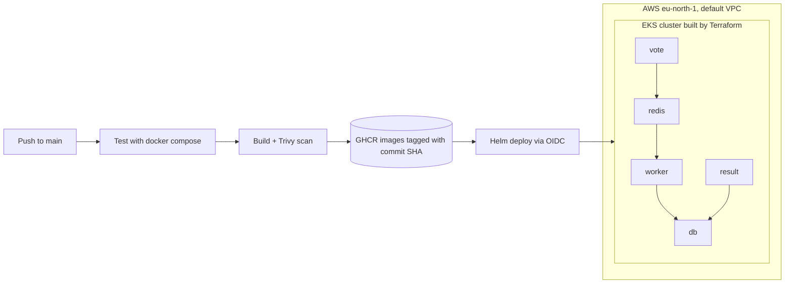

# Capstone 1: Ship It (Example Voting App)

This is my Capstone 1 project. I took Docker's example voting app and built the full pipeline around it. One push to `main` tests the app, scans it, builds the images and deploys it to Kubernetes on AWS.

Original app: [dockersamples/example-voting-app](https://github.com/dockersamples/example-voting-app)

## The app

| Service | Language | What it does |
|---|---|---|
| vote | Python | Web page where you vote cats or dogs |
| redis | Redis | Holds new votes in a queue |
| worker | .NET | Moves votes from Redis into the database |
| db | Postgres | Stores the votes |
| result | Node.js | Web page that shows the results live |

## Architecture



## What's in this repo

```
vote/ result/ worker/      app code and hardened Dockerfiles
docker-compose.yml         run everything on my laptop
.github/workflows/ci.yml   the pipeline
terraform/                 EKS cluster in the default VPC + GitHub OIDC role
helm/voting-app/           one chart, one values file
kind-config.yaml           local Kubernetes cluster for testing the chart
```

## Run it locally

```bash
docker compose up -d --build
```

Vote at http://localhost:8080 and see results at http://localhost:8081.

## Containers

- Base images pinned by digest, not just a tag
- Every container runs as a non-root user
- `.dockerignore` in each service
- Upgraded Node 18 to 24 and .NET 7 to 10 (both were end of life)

## Pipeline

On every push to `main`:

1. **Test**: start the whole app with Docker Compose, check both pages load, cast a vote and check it reaches the database
2. **Build and scan**: build the 3 images and scan them with Trivy. The job fails on any CRITICAL vulnerability that has a fix
3. **Push**: push the images to GHCR, tagged with the commit SHA
4. **Deploy**: log in to AWS with OIDC and run `helm upgrade --install` with the new tag

Third-party actions are pinned by commit SHA.

## Infrastructure (Terraform)

```bash
cd terraform
terraform init
terraform apply
aws eks update-kubeconfig --region eu-north-1 --name voting-app
kubectl create secret generic db-credentials --from-literal=password=postgres
```

To tear it all down: `terraform destroy`. The nodes use `m7i-flex.large` because it's allowed on the AWS Free plan.

## Deploy and roll back with Helm

```bash
helm upgrade --install voting-app helm/voting-app --set image.tag=<commit-sha>
```

Bad release on purpose, then roll back:

```bash
helm upgrade voting-app helm/voting-app --set image.tag=broken-tag --wait --timeout 90s
helm history voting-app
helm rollback voting-app <last-good-revision>
```

While the bad release is failing, the old pods keep running, so the app stays up.

## Secrets

- The database password is a Kubernetes Secret, created by hand. It's not in the chart.
- The pipeline logs in to AWS with OIDC, so no AWS keys are stored in GitHub.
- Terraform state is in `.gitignore`.
- Known limitation: the original app has the password written in `result/server.js` and `worker/Program.cs`. Fixing that means changing the app to read it from an environment variable.

## Problems I hit

- Trivy blocked 3 images: `System.Drawing.Common` in the worker, `proxy-addr` in result, and `perl-base` in the result base image. I fixed each one.
- The OIDC login failed because GitHub now puts the account and repo ID numbers in the token. I found the real value in CloudTrail and updated the trust policy.
- AWS phone verification blocked my account for days. AWS Support verified it by phone.

## What I would improve next

- Use a persistent volume for Postgres instead of `emptyDir`
- Store Terraform state in S3 so it isn't only on my laptop
- Add an Ingress so the app is reachable without port-forward
- Give the Terraform user only the permissions it needs